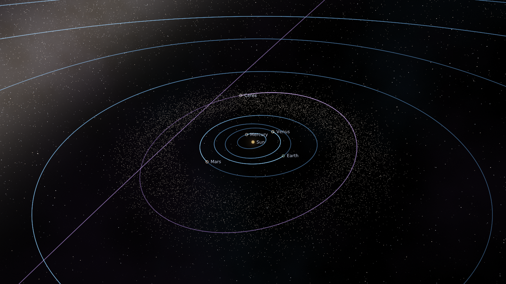

# Solar System Sandbox

An interactive, physically simulated solar system written in **C++17 / OpenGL 3.3**.
Fly from the Sun out to Eris, zoom in on any planet or moon, and bend the rules: change masses,
re-shape orbits, rewind time, change the strength of gravity - and watch what happens.



## Features

* **Real N-body gravity** (kick-drift-kick leapfrog, double precision). The Sun, 8 planets, Ceres, Pluto, Eris and
  **69 moons** (Galilean moons, Titan, Triton, Charon, the shepherd moons, irregular outer moons, ...) all pull on each
  other, so every tweak has real consequences. Time is reversible.
* **Zoom from the whole system down to a moon's surface** with the mouse wheel. Moons fade in as you zoom close enough
  to their planet.
* **Stylized / true scale switch.** Stylized enlarges bodies (and the spread of moon systems) so everything is
  visible; true scale shows real size ratios.
* **Orbit editor** - change a body's semi-major axis, eccentricity, inclination or give it a speed boost. A pink
  *preview orbit* is drawn in 3D together with a Now/After table (period, closest/farthest approach, speeds) and a list
  of **consequences**: crossing other planets' orbits, falling into the Sun, impact, Roche-limit break-up,
  Hill-sphere instability (moon gets stolen), escape trajectories ...
* **Mass tweaks** for every body (0.01x - 1000x): surface gravity, escape velocity, density, Hill sphere, moons that will
  be lost. Heavier Sun = brighter, bigger Sun (mass-luminosity relation) and a shifted habitable zone.
* **Time controls**: pause, reverse, 1 s/s up to years/s (the CPU caps the top end at roughly 1 year/s; the UI tells you when it is limiting), with a live calendar date. **Gravity (G)** slider.
* **Description panel** for every planet and moon: a live rotating portrait, written description and a fact table
  (mass, radius, density, gravity, escape velocity, day length, tilt, temperature, orbit data, distances ...).
* **Visuals**: fully procedural planets (no texture files) - Earth with continents, clouds, ice caps, ocean glints and
  city lights; banded Jupiter with the Great Red Spot; Saturn's rings with Cassini division, planet shadow on the rings
  and ring shadow on the planet; cratered Moon/Mercury; Io, Europa, Titan, Pluto's heart ... plus analytic atmospheres,
  an animated Sun, GPU-animated asteroid and Kuiper belts, a procedural Milky Way, HDR bloom, ACES tone mapping and
  4x MSAA.

## Controls

| Input | Action |
| --- | --- |
| Mouse wheel | zoom in / out |
| Drag with left **or wheel/middle** button | rotate the view |
| Shift + wheel / Ctrl + wheel | spin sideways / tilt |
| Click / double-click a body | select / fly to it |
| `Space` | pause / play |
| `R` | reverse time |
| `[` / `]` | slower / faster |
| `F`, `Home` | focus selected / reset view |
| `0`-`8` | jump to Sun, Mercury ... Neptune |
| `L` `O` `T` `H` | toggle labels / orbits / trails / interface |
| Arrow keys | rotate |
| `F12` | save a screenshot |

## Building

Requires **CMake >= 3.20**, a C++17 compiler and a GPU/driver with OpenGL 3.3. Dependencies (GLFW, GLM, Dear ImGui)
are downloaded automatically by CMake; OpenGL function loading uses a pre-generated glad bundled in `third_party/`.

### Windows (Visual Studio 2019/2022)

```bat
cmake -S . -B build -G "Visual Studio 17 2022" -A x64
cmake --build build --config Release
build\Release\solar_sandbox.exe
```

(or open the folder in Visual Studio / VS Code with the CMake extension). The `shaders` folder is copied next to the exe.

### Linux

```bash
sudo apt install build-essential cmake libxrandr-dev libxinerama-dev libxcursor-dev libxi-dev libgl1-mesa-dev
cmake -S . -B build -DCMAKE_BUILD_TYPE=Release && cmake --build build -j
./build/solar_sandbox
```

### macOS

```bash
cmake -S . -B build -DCMAKE_BUILD_TYPE=Release && cmake --build build -j && ./build/solar_sandbox
```

## Command line options

`--width N --height N`, `--focus Saturn`, `--select Titan`, `--dist KM`, `--true-scale`, `--system`, `--tab orbit|mass`,
`--screenshot out.png --frames N` (render N frames, save a PNG and quit - handy for documentation).

## Tests

```bash
./build/sim_test     # orbital periods, energy conservation, time reversibility, mass-tweak dynamics
```

## Project layout

```
src/catalog.*   body data (masses, radii, orbital elements, descriptions)
src/orbit.*     state vectors <-> Keplerian elements
src/sim.*       the N-body simulation
src/renderer.*  OpenGL renderer (HDR targets, bloom, draw passes)
src/ui.*        Dear ImGui panels, orbit editor, labels
src/main.cpp    window, input, camera, scene assembly
shaders/        GLSL (procedural planets, atmospheres, rings, sky, bloom ...)
```

## Data notes

Planetary orbits use JPL J2000 mean elements; moon orbits use published semi-major axes, eccentricities and
inclinations. Where an exact orbital phase is unknown (most moons) a deterministic pseudo-random phase is used. The
simulation starts at the J2000 epoch (2000-01-01 12:00).
